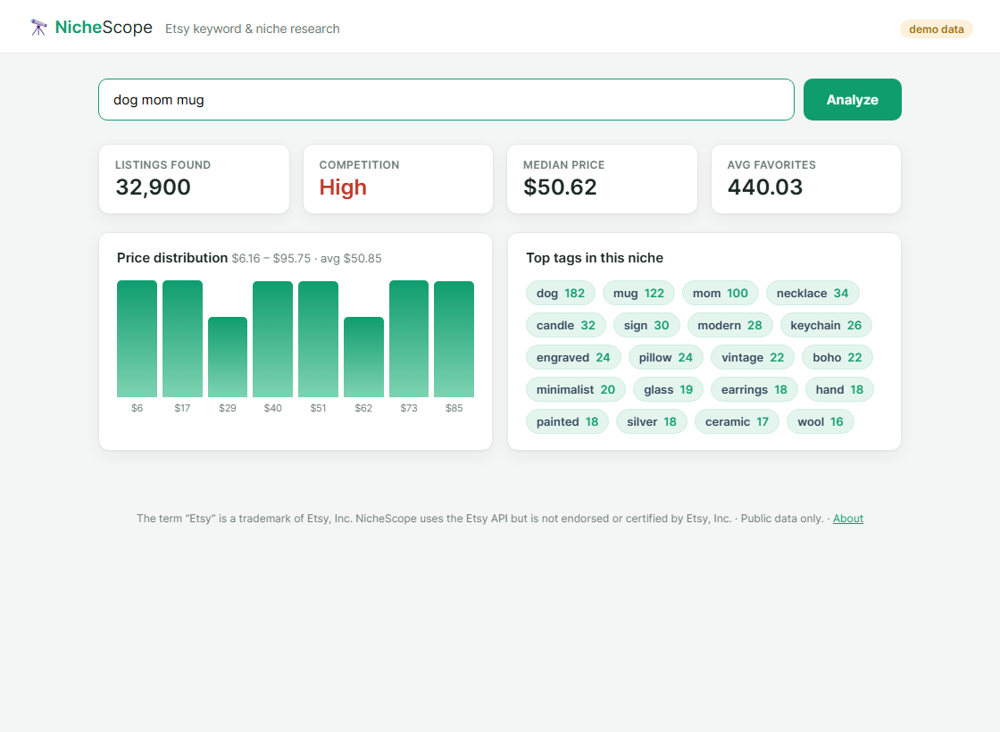

# 🔭 NicheScope — Etsy keyword & niche research

A personal research tool: type a keyword and see how competitive that Etsy niche is —
listing volume, price distribution, average favorites, and the tags that dominate the
top results. Built on the **Etsy Open API v3** (public endpoints only, no OAuth).

> NicheScope is a personal, non-commercial tool for its owner. The term "Etsy" is a
> trademark of Etsy, Inc. This application uses the Etsy API but is not endorsed or
> certified by Etsy, Inc.



## What it reports

- **Competition** — a Low/Medium/High read from listing volume.
- **Price distribution** — min/median/avg/max plus an 8-band histogram.
- **Favorites** — average and peak interest across sampled listings.
- **Top tags** — the most frequent tags/keywords among results, so you can see how sellers position in that niche.

## Tech

Python + **FastAPI** + Jinja2 templates, vanilla-JS frontend, `httpx` for the Etsy calls.
No database. Runs in **demo mode** with generated sample data when no API key is set.

## Run it

```bash
python -m venv .venv && . .venv/Scripts/activate    # Windows: .venv\Scripts\activate
pip install -r requirements.txt
python main.py                                       # http://127.0.0.1:8000
```

For live data: apply for a key at <https://www.etsy.com/developers/register>, copy
`.env.example` to `.env`, and set `ETSY_API_KEY`.

## Layout

```
main.py            FastAPI app + routes
app/etsy.py        Etsy v3 public search client (httpx)
app/analysis.py    metrics: price stats, histogram, tag frequency
app/mock.py        demo-mode sample data
templates/         Jinja2 templates
static/            CSS, JS, about page
```

## Notes on data use

NicheScope computes statistics on the fly and stores nothing, in line with Etsy's API
Terms of Use (including caching limits). It reads only public listing data.
